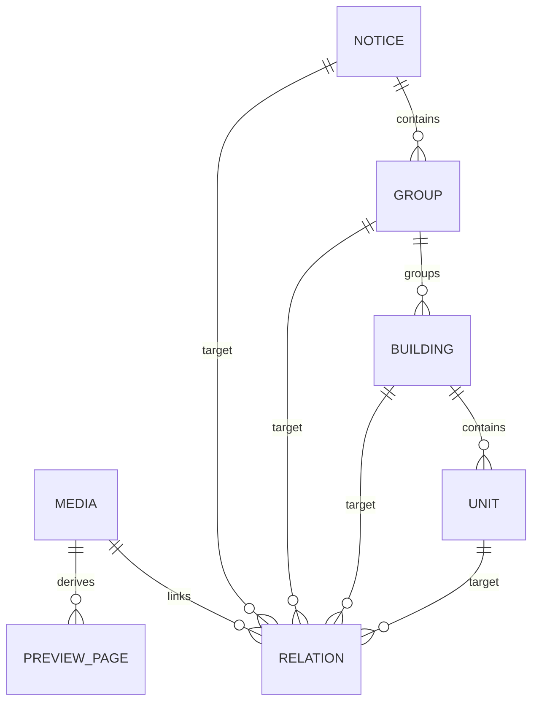

# 주택 공고·미디어 표준 데이터 1.0.0

이 표준은 특정 공고의 파일명, 세대수, 지역, 엑셀 행 번호와 화면 코드를 분리하기 위한 입력 규약이다. 기준 스키마는 `data/schema/notice-dataset.schema.json`이며, 검증과 화면 데이터 생성은 `scripts/dataset.py`가 수행한다. 두 경로는 작업공간과 각 실행 폴더(`lh-runs/<실행>/`)에 같은 위치로 있다.

실제 패키지 예시는 작업공간의 `data/datasets/2015122300020927/dataset.json`과 각 실행 폴더의 `data/datasets/<noticeId>/dataset.json`이다. 프로그램은 특정 지역이나 세대 수에 의존하지 않는다.

## 1. 패키지와 최상위 구조

```text
data/datasets/<공고 ID>/
  dataset.json
  assets/
    files/                  원본 PDF·이미지·PPTX·XLSX
    previews/<원본 파일 ID>/
      page-001.webp
      page-002.webp
      thumb.webp
```

`dataset.json`의 로컬 URL은 패키지 기준 `assets/...` 상대 경로다. 절대 파일 경로, 상위 디렉터리 이동, 심볼릭 링크를 통한 패키지 밖 참조, 쿼리·프래그먼트를 허용하지 않는다. 원문 사이트 주소는 별도의 HTTPS `sourceUrl`에 둔다.

최상위 필드는 다음과 같다.

| 필드 | 역할 |
|---|---|
| `schemaVersion` | 현재 지원값 `1.0.0`. 알 수 없는 버전은 반영하지 않는다. |
| `notice` | 공고 ID, 제목, 날짜, 출처, 화면 제목·지역·배지·필터 구간 |
| `groups` | 모집단위인 주택군 |
| `buildings` | 주택군에 속한 건물·원문 주소와 검증한 좌표 |
| `units` | 원본 세대별 조건과 원본 셀·행 정보 |
| `media` | 원본 파일과 그 파일에서 파생한 미리보기 |
| `relations` | 미디어가 어느 공고·주택군·건물·세대의 자료인지 정의 |
| `extensions` | 공급정보 등 화면 핵심 모델 밖의 추가 자료 |

세대수·건물수·주택군 수·최소/최대 보증금은 프로그램이 계산한다. 사람이 입력한 합계를 화면이 그대로 믿도록 하지 않는다.

## 2. 식별자와 관계



- 모든 엔티티의 `id`는 각 목록에서 고유해야 한다.
- 공고 ID와 원본 주택군·주소·원본 순번에서 안정적인 ID를 만든다. 엑셀 행 순서가 바뀌었다고 건물 ID가 바뀌지 않는다.
- 공고 ID가 다르면 저장 목록도 분리한다. 동일 공고를 갱신할 때는 원본 식별 의미가 같은 레코드의 ID를 유지한다.
- 원본 세대 순번은 `units[].originalId`에 별도로 보관한다. 화면에는 이 순번을 표시하고 내부 연결에는 표준 ID를 사용한다.
- 같은 주소라도 원문에서 서로 다른 주택군이면 주택군과 주소의 조합으로 구분한다.
- 같은 도로명 위치에 A/B동이 있더라도 원문 주소를 합치지 않는다. 지도에서 같은 좌표의 주소를 묶어 선택한다.

가져오기 도구가 안정 ID를 자동 생성한다. 직접 표준 데이터를 작성할 때는 `tools.dataset.stable`을 재사용한다. 그룹은 `stable(공고ID, 'group', 주택군명)`, 건물은 `stable(공고ID, 'building', 주택군명, 원문주소)`, 세대는 `stable(공고ID, 'unit', 주택군명, 원문주소, 원본순번)`이다. 이 함수는 값 배열의 공백 없는 UTF-8 JSON을 SHA-256으로 해시한 앞 20자를 사용하고 `<공고ID>:<종류>:`를 붙인다. 원본 순번의 숫자/문자열 구분도 유지한다. 존재하지 않는 ID를 임의로 붙인 뒤 다른 레코드의 연결만 고쳐 맞추지 않는다.

## 3. 공고와 화면 설정

`notice`에는 다음 정보를 둔다.

| 필드 | 의미 |
|---|---|
| `id`, `title` | 공고 식별자와 원문 제목 |
| `noticeDate`, `collectedDate` | `YYYY-MM-DD` 형식 공고일·수집일 |
| `sourceUrl` | 원문 공고의 HTTPS URL |
| `regionLabel`, `kind` | 화면 상단 지역과 유형 |
| `appTitle`, `badge` | 화면 제목과 공고 배지. 새 공고에서 ‘정정공고’를 고정 표시하지 않는다. |
| `providerShort`, `providerName` | 공급기관 표시 |
| `description` | 화면 설명 |
| `spreadsheet` | 기준 파일 ID·이름·시트·열·원본 안내문 등 출처 정보 |
| `filterConfig` | 공고에 맞는 보증금·면적 필터 구간 |

`filterConfig.depositBands`와 `areaBands`는 `{ "value": "하한-상한", "label": "화면 문구" }` 배열이다. 숫자 단위는 원·㎡이며, 상한이 없으면 `Infinity`를 사용한다. 미기재를 선택하려면 `value: "missing"`을 사용한다. 경계는 하한 포함·상한 제외다. `150000000-200000000`은 1.5억 이상 2억 미만이다. 지역·방수·주택유형 선택값은 세대 데이터에서 만든다.

## 4. 건물과 세대

건물은 `groupId`, `address`, `city`, `location`을 가진다. `address`는 원문을 보존한다. 조회용 정규화 주소와 원문 주소는 구분한다.

`location`에는 위도·경도, `status: "validated"`, 위치 출처와 일치 주소를 둔다. 위도는 -90~90, 경도는 -180~180 범위다. 아직 위치를 확인하지 못한 건물을 도시 중심점에 임의로 배치하지 않는다. 좌표 검증이 끝나지 않으면 활성화를 중단한다.

세대의 주요 필드는 다음과 같다.

| 필드 | 원본 의미·단위 |
|---|---|
| `buildingId` | 해당 건물 표준 ID |
| `originalId` | 엑셀 순번. 숫자 또는 문자열 |
| `province`, `supplyRegion`, `group`, `address` | 시도·시군구·모집단위·주소 |
| `building`, `unit` | 동·호. 문자 식별값으로 보존 |
| `areaBand` | 원본 공급형 문구 |
| `area`, `expandedArea`, `exclusiveArea` | 실사용·확장·전용면적, ㎡ |
| `rooms`, `floor` | 방수와 원본 층수 |
| `elevator` | 있음 `true`, 없음 `false`, 원본 미기재 `null` |
| `type`, `deposit`, `notes` | 유형·보증금(원)·비고 |
| `sourceRow`, `rawFields` | 원본 행 번호와 A·B·C 등의 셀 원문 |

미기재 숫자는 `null`로 둔다. 0으로 바꾸거나 다른 면적으로 대체하지 않는다. 원본의 오탈자로 의심되는 값도 조용히 수정하지 않는다. 사용자가 확인한 별칭 매핑이 필요하면 가져오기 설정에 명시하고 원본 셀은 보존한다.

## 5. PDF와 이미지의 공통 미디어 모델

PDF·이미지·PPTX·XLSX를 모두 `media` 레코드로 관리한다. 확장자만으로 어떤 건물의 자료인지 추측하지 않는다. 연결 대상은 반드시 `relations`로 지정한다.

### 원본

`media.original`은 `url`, `sourceUrl`, `sha256`, `size`를 가진다. `sha256`은 실제 원본 파일 바이트의 SHA-256이고 `size`는 바이트 수다. 원본의 이름은 `media.name`, 형식은 `media.type`에 둔다. 같은 PDF가 여러 건물에 사용되면 원본을 복제해 다른 자료인 것처럼 만들지 않고 여러 관계로 연결할 수 있다. 수집 사이트가 서로 다른 파일 ID를 제공했다면 그 출처도 보존한다.

### 파생 이미지와 썸네일

`media.preview`에는 `status`, `pageCount`, `pages`, `thumbnail`이 있다.

- `ready`: 이미지 미리보기가 준비되어 있다.
- `download-only`: 원본 다운로드만 제공한다. `pages: []`, `thumbnail: null`이어야 한다.
- `unavailable`: 미리보기가 없음을 명시한다. 준비된 것으로 표시하지 않는다.

각 페이지는 다음처럼 원본 부모를 명시한다. 아래는 페이지 레코드의 형태 예시다.

```json
{
  "pageNumber": 1,
  "url": "assets/previews/catalogue-001/page-001.webp",
  "derivedFromMediaId": "notice-001:media:catalogue-001",
  "width": 1600,
  "height": 1132
}
```

- PDF: 모든 페이지를 1부터 연속된 번호로 변환한다. 첫 페이지만 변환하고 완료 처리하지 않는다.
- JPG·PNG·WebP 원본: 원본 자체를 가리키는 `derivedFromMediaId`와 단일 페이지 1을 갖는다.
- PPTX: 모든 슬라이드가 페이지다. 원본 부모는 PPTX 미디어 ID다.
- XLSX: 기본적으로 `download-only`다. 원본 다운로드를 유지한다.
- 썸네일도 `url`, `derivedFromMediaId`, `pageNumber`를 가진다. 어느 원본의 어느 페이지에서 만들었는지 식별한다.

`pageCount`는 실제 페이지 수와 같아야 한다. 페이지 중복·번호 누락·잘못된 부모 ID·이미지 크기 불일치는 오류다. PDF와 PPTX의 실제 페이지/슬라이드 수도 도구가 확인한다. 미리보기는 원본을 대체하지 않는다.

### 출처

`provenance`는 원본 사이트의 파일 ID(`sourceId`), 수집 분류(`kind`), 주택군 이름, 자료에 표시된 주소, 수집 엔드포인트를 보존한다. 같은 위치라는 연결을 주장할 때에는 자료 주소의 검증 좌표도 함께 둔다.

## 6. 미디어 연결 표준

`relations`의 필드는 `id`, `mediaId`, `targetType`, `targetId`, `role`, `match`, `sourceAddress`다.

| `targetType` | 대상 예 |
|---|---|
| `notice` | 공고문·QnA·주택목록 |
| `group` | 로렌하우스 주택군 공통 안내서 |
| `building` | 특정 주소의 홍보물·외관 사진 |
| `unit` | 특정 세대만의 평면도·사진 |

`role`은 `announcement`, `qna`, `inventory`, `brochure`, `floorplan`, `photo`, `other` 중 하나다. `match`는 다음 뜻을 가진다.

| `match` | 표시와 검증 의미 |
|---|---|
| `explicit` | 출처 확인 후 연결 대상을 명시적으로 지정 |
| `address` | 자료 주소와 건물 원문 주소가 공백 정리 후 일치 |
| `location` | 같은 주택군이며 검증한 좌표가 일치 |
| `group` | 같은 주택군의 공통 자료. 해당 건물 전용이라고 주장하지 않음 |

하나의 파일은 여러 대상에 연결할 수 있고 하나의 대상도 여러 파일을 가진다. 동일한 파일·대상·역할 관계를 중복 등록하지 않는다. 참조 대상이 없거나 원본 미디어가 없는 관계는 오류다. 사용되지 않는 미디어도 검증에서 확인한다.

세대 전용 미디어는 해당 세대가 필터 결과에 남았을 때만 보여야 한다. 주택군·건물 공통 자료와 세대 전용 자료를 합쳐서 건물 전체 자료인 것처럼 표시하지 않는다. 동일 파일이 여러 경로로 연결되면 화면은 하나의 파일로 모으되 모든 연결 근거를 유지한다.

## 7. 검증과 활성화 계약

`validate`는 스키마와 ID·참조·단위·좌표·원본 해시·파일 존재·페이지 관계를 확인한다. `build`는 검토할 별도 결과만 만든다. `activate`는 검증과 파일 복사가 모두 성공한 뒤 화면의 데이터 포인터를 교체한다.

`activate`와 `build`는 같은 사이트 폴더에 `competition-config.json`도 만든다. 공고 ID, `notice.sourceUrl`, 총 세대수, 주택군 이름 목록을 담으며, 경쟁률 백엔드가 이 파일을 소스로 쓴다. 소스 URL을 바꾸려면 `notice.sourceUrl`을 고친 뒤 다시 활성화한다.

화면은 원본 표준 파일을 임의 수정하지 않는다. 사이트 폴더(작업공간 `public/`, 실행 폴더 `site/dist/`)의 `data.js`와 `competition-config.json`은 생성물이며 직접 편집하지 않는다. 데이터 교체 순서와 오류 해결은 [`DATA_GUIDE.md`](DATA_GUIDE.md)를 따른다.
